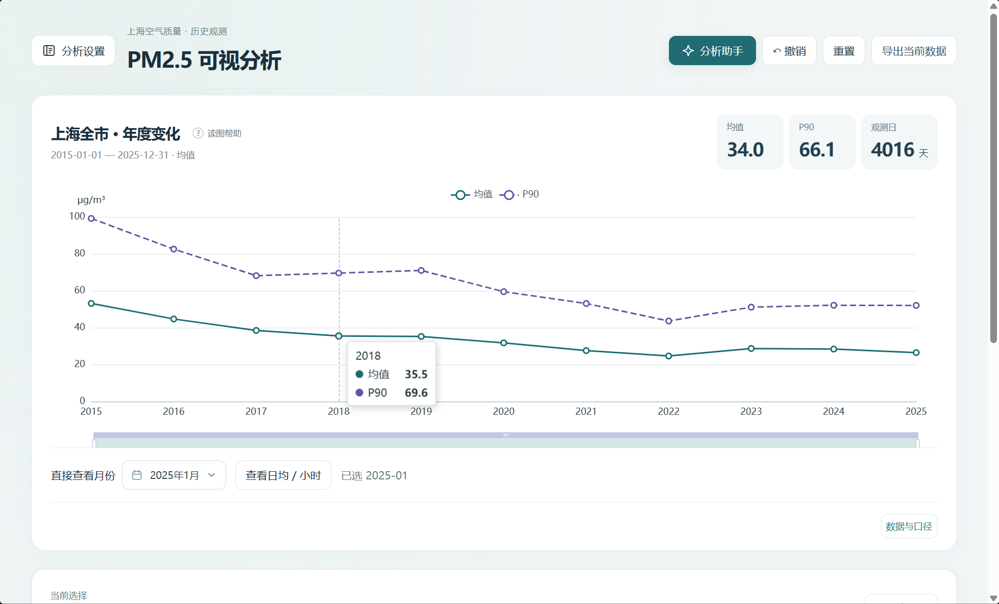
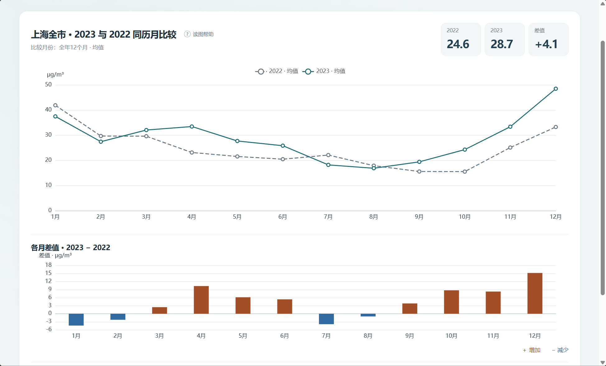
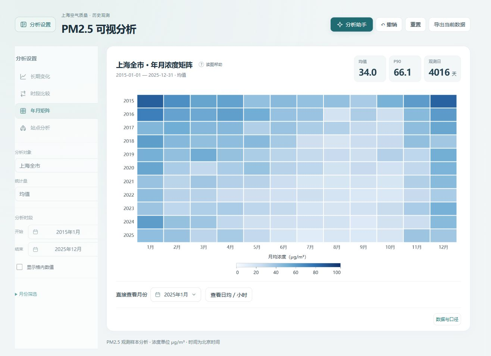
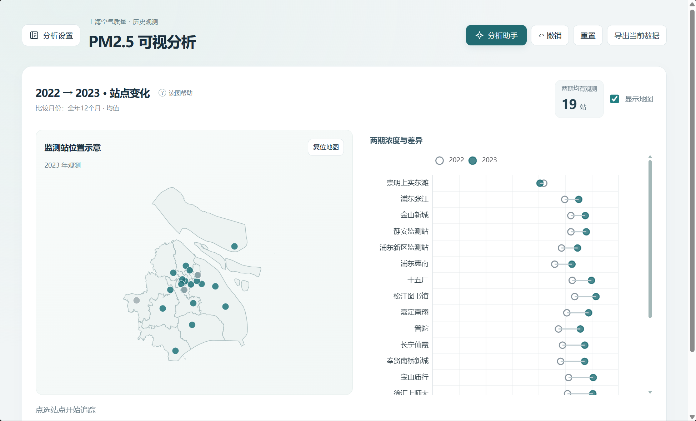
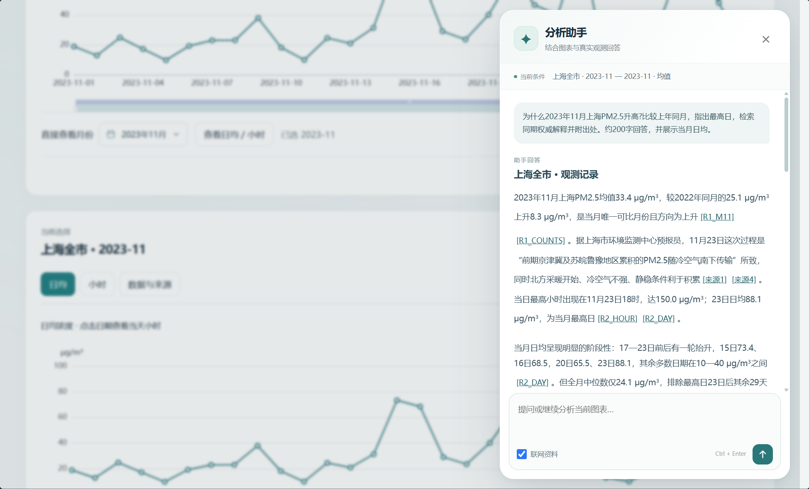

# Shanghai Air Quality

上海PM2.5交互分析应用。React、TypeScript与ECharts组成前端，FastAPI提供统计接口，LangGraph协调AI工具调用与有来源的分析回答。

项目原创代码采用[MIT许可证](LICENSE)。第三方数据与地图的授权范围见[DATA_LICENSE.md](DATA_LICENSE.md)，依赖许可见[第三方说明](THIRD_PARTY_NOTICES.md)。

## 界面预览

**长期变化**：同时查看年度均值与P90，通过图表选择和月份入口进入日均、小时明细。

[](docs/images/annual-trend.png)

| 时段比较 | 年月浓度矩阵 |
| --- | --- |
| [](docs/images/period-comparison.png) | [](docs/images/monthly-matrix.png) |
| 对照两年的月均浓度与各月增减。 | 按统一色阶比较年份和月份，点选查看明细。 |
| **站点分析** | **AI分析助手** |
| [](docs/images/station-analysis.png) | [](docs/images/ai-assistant.png) |
| 地图选站，比较站点两期浓度并追踪变化。 | 自然语言提问，结合本地查询与联网资料回答，并附事实和来源引用。 |

## 启动

需要 Python 3.12 和 Node.js 24。在项目根目录使用对应系统的脚本：Windows 使用 PowerShell，Linux/macOS 使用 Bash；Git Bash 也可使用 `.sh` 入口。脚本会自动定位项目目录，无需激活虚拟环境。

| 操作 | Windows / PowerShell | Linux、macOS / Bash |
| --- | --- | --- |
| 首次安装与构建 | `.\scripts\setup.ps1` | `./scripts/setup.sh` |
| 启动后端 | `.\scripts\start-backend.ps1` | `./scripts/start-backend.sh` |
| 启动前端 | `.\scripts\start-frontend.ps1` | `./scripts/start-frontend.sh` |
| 使用后端统一提供构建后的页面 | `.\scripts\start.ps1` | `./scripts/start.sh` |
| 数据、测试与构建检查 | `.\scripts\check.ps1` | `./scripts/check.sh` |

首次运行安装脚本，然后打开两个终端，分别启动后端与前端。浏览器访问 [http://127.0.0.1:5173/](http://127.0.0.1:5173/)，前端通过 Vite 将 `/api` 请求转发到后端。

也可以只运行 `start` 脚本，由后端统一提供页面和接口，浏览器访问 [http://127.0.0.1:8000/](http://127.0.0.1:8000/)。运行不需要重新下载或处理数据。

安装时指定 Python 解释器，PowerShell 使用 `-Python python3.12`，Bash 使用 `--python python3.12`；解释器路径包含空格时加引号。Bash 脚本识别 `.venv/bin/python`，也识别 Git Bash 下的 `.venv/Scripts/python.exe`。

修改端口时，PowerShell 后端使用 `-Port 8035`，前端使用 `-Port 5175 -ApiPort 8035`；Bash 对应使用 `--port 8035` 和 `--port 5175 --api-port 8035`。后端热重载选项分别为 `-Reload` 和 `--reload`，各 Bash 脚本均支持 `--help`。

## 功能

工作台包括长期变化、时段比较、年月矩阵和站点分析。支持即时筛选、均值与P90对照、月内日均和小时下钻、连续高值过程、站点地图与追踪、撤销及CSV导出。统计使用全部已有有效观测，缺测不补零。

分析助手能够解释统计概念、组合本地查询、回答变化问题，并引用可返回原记录的事实。联网解释使用当前实现支持的DeepSeek Search；其他OpenAI兼容服务仍可用于本地数据分析。真实调用需要服务商密钥，手动浏览图表和运行测试不调用模型。

把 `.env.example` 复制为 `.env.local`，填写 `AIR_AI_BASE_URL`、`AIR_AI_MODEL`、`AIR_AI_API_KEY`。密钥只由后端读取，本地配置与会话数据库不进入 Git。环境变量可覆盖配置文件。前端不保存或接收服务密钥。

## 数据与处理

`data/processed/` 已随仓库提供可直接使用的清洗后数据，约17MB，包含城市和站点日均、分区小时记录、站点目录、地图及来源校验清单。城市记录覆盖2015—2025年，站点包含2021—2025年及2018年八月、十二月历史记录。[数据说明](docs/data.md)列出来源、统计口径和重建方式。

```powershell
.\.venv\Scripts\python.exe -m pipeline.verify
.\.venv\Scripts\python.exe -m pipeline.rebuild --output data/rebuilt
```

Linux/macOS：

```bash
./.venv/bin/python -m pipeline.verify
./.venv/bin/python -m pipeline.rebuild --output data/rebuilt
```

第二条命令从仓库内的清洗后小时记录重算日均和汇总，默认不覆盖正在使用的数据。原始全国 CSV 或 ZIP 的清洗入口为 `python -m pipeline.clean --help`。原始大文件不随仓库提供，日常运行和重算已有统计均不需要它们。

## 验证

Windows 运行 `.\scripts\check.ps1`，Linux/macOS 或 Git Bash 运行 `./scripts/check.sh`。

检查数据校验值、后端测试、前端测试和生产构建。AI测试使用离线模拟服务，不消耗模型调用。

前后端已经运行时，还可以核对真实HTTP接口、开发代理和后端托管的构建资源：

```powershell
.\.venv\Scripts\python.exe scripts/smoke.py
```

Linux/macOS 使用 `./.venv/bin/python scripts/smoke.py`。

验证范围及数据版本见[运行验证](docs/verification.md)。

## 目录

```text
api/               FastAPI接口、契约和LangGraph分析助手
analysis/          共用统计函数
pipeline/          原始CSV清洗、已有小时数据重算与校验
frontend/          React工作台、地图及前端测试
data/processed/    已清洗的可运行数据集
data/runtime/      本机会话与检查点，自动创建且不提交
scripts/           安装、启动和检查
tests/             后端与数据处理测试
docs/              运行数据说明
```

